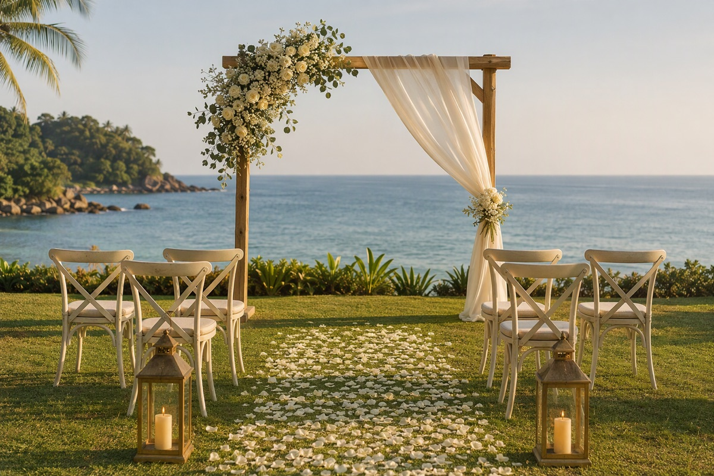
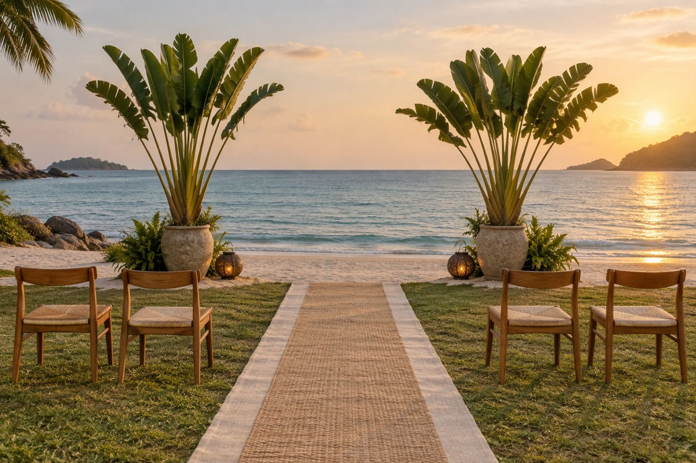
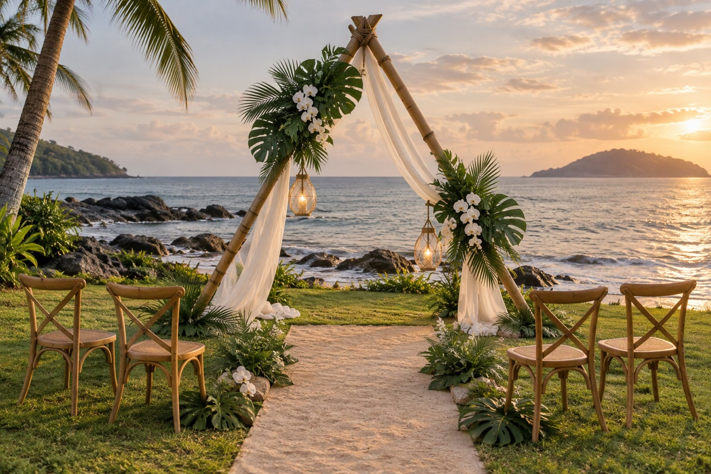
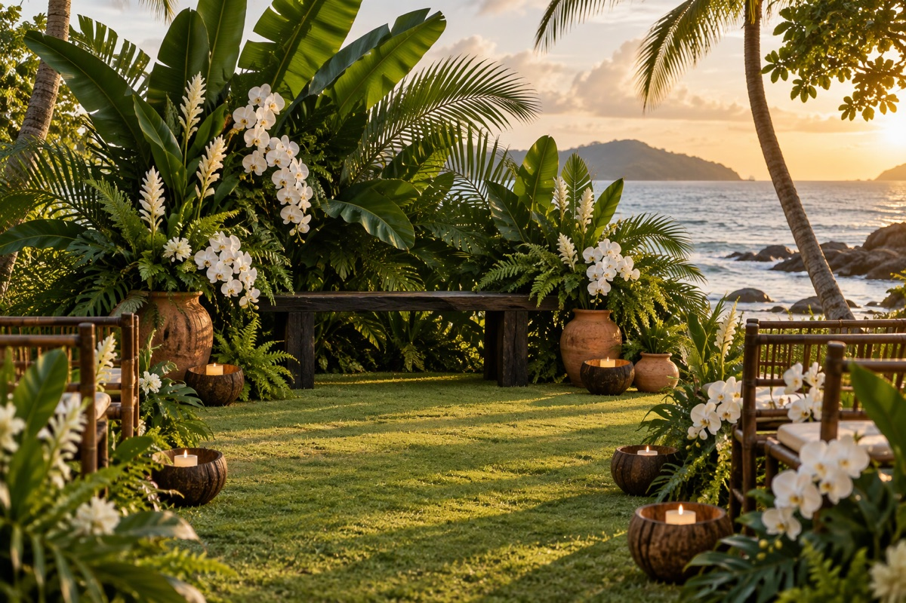
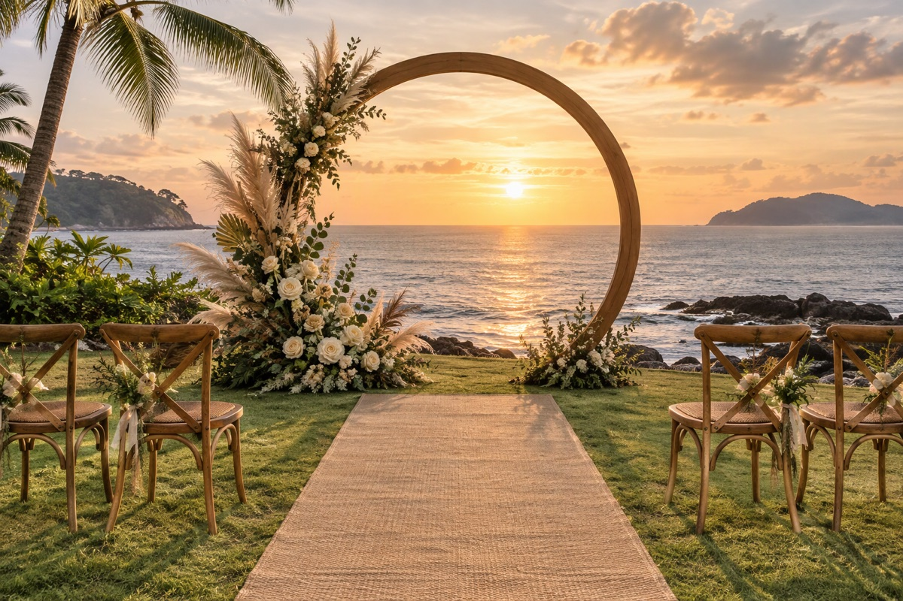
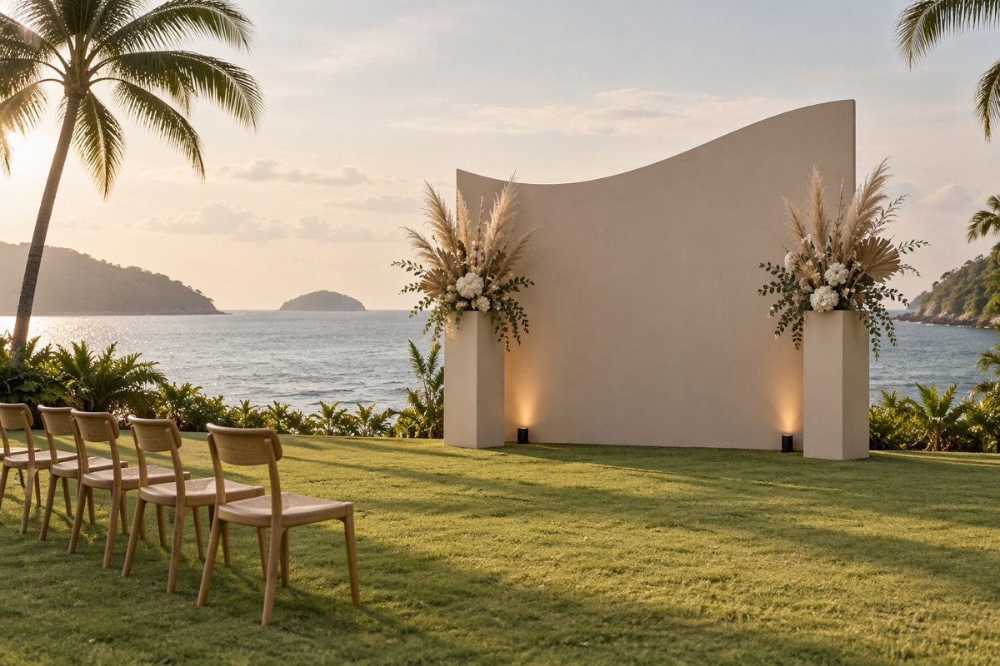
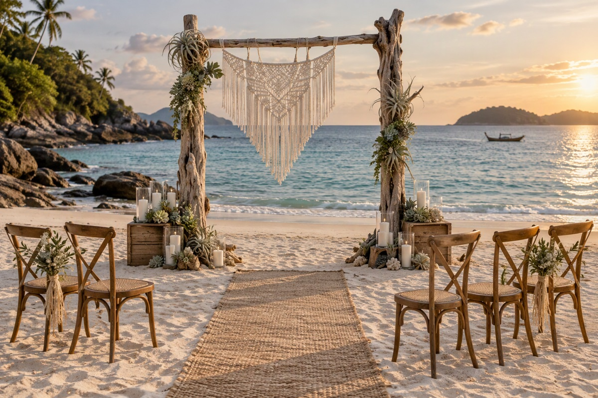
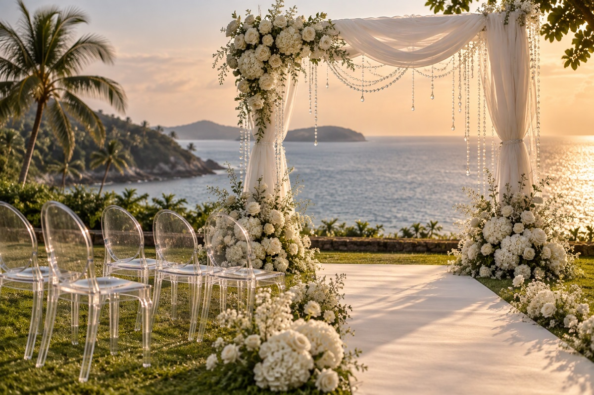
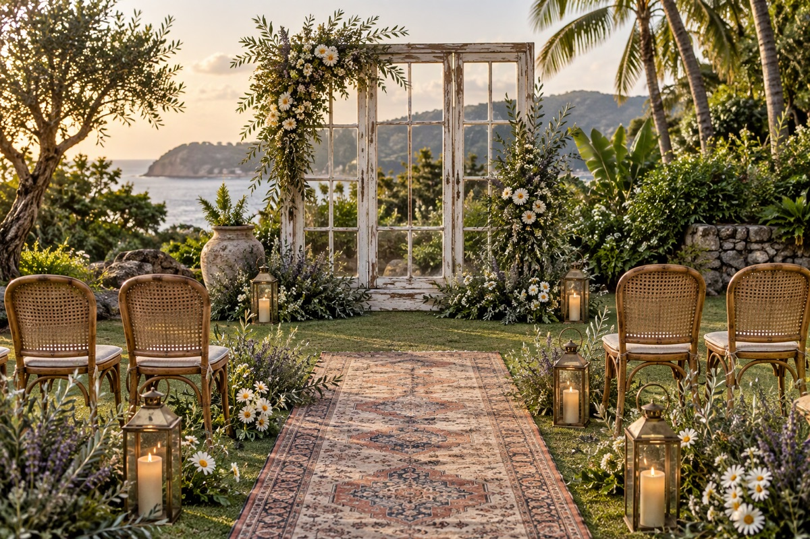
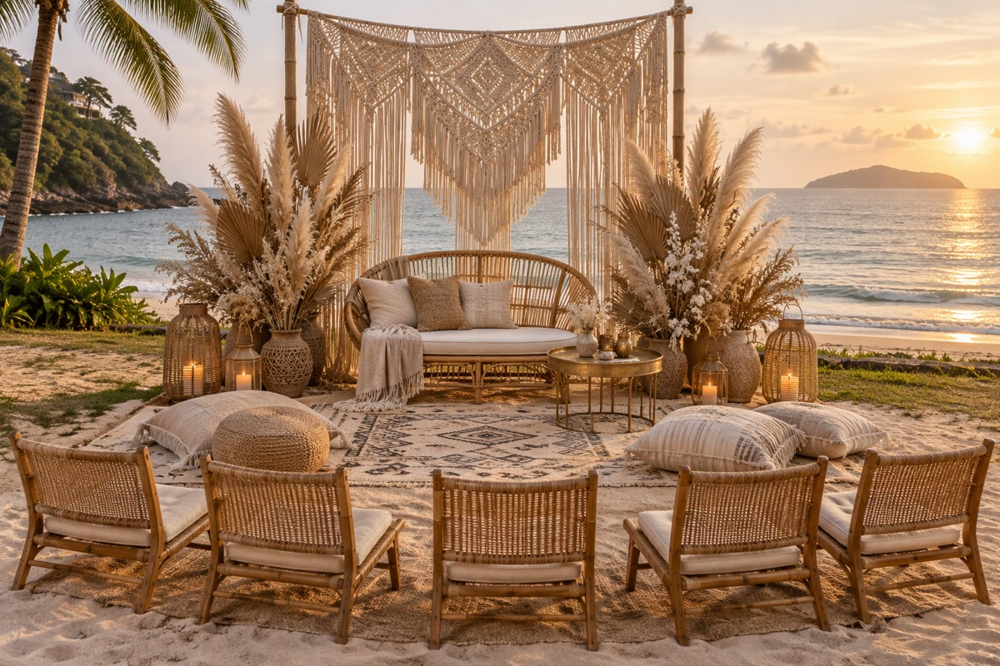

# 仪式布景 · 10 套搭配（海滩草坪版）

> 适用：**2027-01-23（周六）· SALA Phuket** 海滩草坪 / 沙滩 · 5 人 · 主纱 · **17:40 仪式 · 18:30 日落**
> 配图均为 **AI 概念效果图**（统一角度与光线），用于和布置商对齐风格与元素；报价请以供应商实拍案例为准。
> 预算为普吉本地布置参考价，含搭建与撤场，不含酒店场地费与特殊花材升级。

## 先给结论：三选一

| 选择 | 方案 | 预算（THB） | 理由 |
|---|---|---|---|
| 🥇 **默认首选** | **01 奶油海雾** | 12,000–18,000 | 和主纱最搭，拱门 + 不对称白花 + 花瓣通道，5 人规模不空；Simple 已含拱门时可只加通道与椅子 |
| 🥈 **要一张压场照片** | **05 月门** | 15,000–22,000 | 圆拱把两人和日落框在一起，最容易出“年度照片”；沙地必须平台 |
| 🥉 **预算 / 规则优先** | **02 零拱门·海平线** | 5,000–8,000 | 不搭拱门，最不踩国家公园限制，海平线最干净；适合把预算留给摄影 |

> **不建议**：06 极简沙丘（实心板挡海平线，只适合室内雨备）、08 白纱水晶（20,000–28,000，5 人规模撑不起来）。

## 先定三条底线

- **收小**：拱门 1.8–2.2m、通道 4–6m、5 把椅子（3 把有靠背），不要按 50 人规模买布置。
- **抗风**：沙滩 / 草地必须垫板 + 配重；纱幔要夹、蜡烛全换 LED；公共海滩不能封闭，明火、钉桩与夜间灯光需酒店 / 国家公园书面确认。
- **别堵海平线**：背景做太满会挡住日落，西侧留空，逆光轮廓才出片。

## 快速对比

| # | 方案 | 主色 | 核心元素 | 预算（THB） | 最适合 |
|---|---|---|---|---|---|
| 01 | 奶油海雾 | 奶油白 + 鼠尾草绿 | 原木拱门 + 不对称白花 + 花瓣通道 | 12,000–18,000 | 最稳，和主纱最搭 |
| 02 | 零拱门·海平线 | 沙色 + 白 | 双旅人蕉 + 亚麻通道 + 低背木椅 | 5,000–8,000 | 预算紧 / 怕规则限制 |
| 03 | 竹与白纱 | 原竹 + 象牙白 | 竹竿三角拱 + 白纱 + 龟背竹 | 8,000–12,000 | 想要普吉本地感 |
| 04 | 热带芭蕉 | 深绿 + 白 | 芭蕉叶背景 + 木长凳 + 陶罐 | 10,000–16,000 | 要颜色与热带感 |
| 05 | 月门 | 原木 + 奶油花 | 2m 圆拱 + 底部花艺 + 米色通道 | 15,000–22,000 | 要一张压场照片 |
| 06 | 极简沙丘 | 燕麦 + 沙色 | 弧形背景板 + 蒲苇 + 地灯 | 12,000–18,000 | 现代感 / 室内雨备 |
| 07 | 漂流木 | 灰褐 + 白 | 漂流木柱 + macrame + 黄麻毯 | 8,000–12,000 | 最松弛 |
| 08 | 白纱水晶 | 纯白 + 银 | 纱幔 + 水晶串 + 幽灵椅 | 20,000–28,000 | 最华丽 |
| 09 | 旧木窗 | 做旧木 + 野花 | 旧窗框 + 复古地毯 + 黄铜灯 | 14,000–20,000 | 温柔，长辈会喜欢 |
| 10 | 沙色波西米亚 | 沙色 + 藤色 | macrame + 藤椅 + 摩洛哥毯 | 10,000–16,000 | 最像度假 |

---

## 01｜奶油海雾（最稳，首选）



- **搭配**：2.2m 原木拱门 + 不对称白玫瑰、满天星、尤加利 + 象牙色木椅 + 4–6m 花瓣通道 + 2 盏落地灯。
- **出片**：逆光下的头纱和拱门轮廓，和主纱最搭。
- **注意**：SALA Simple 套餐已含花拱门的话，**别买第二个拱门**，把钱加到通道和椅子上。

## 02｜零拱门·海平线（最省、最不踩规则）



- **搭配**：不搭拱门；两侧各一盆旅人蕉 / 大棕榈 + 亚麻通道毯 + 5 把低背木椅 + LED 椰壳灯。
- **出片**：干净海平线、剪影、日落，越简单越高级。
- **注意**：避开游客入镜；长辈坐草坪侧，不坐软沙。

## 03｜竹与白纱（普吉本地感）



- **搭配**：竹竿三角拱（绑扎不打钉）+ 白纱 + 龟背竹 / 棕榈叶 + 2 盏玻璃吊灯（LED）。
- **出片**：线条自然，和海滩不违和。
- **注意**：竹色要统一、接口打磨；大风天把纱收起来。

## 04｜热带芭蕉（颜色最饱满）



- **搭配**：芭蕉叶背景 + 白兰花 / 姜花 + 深色木长凳 + 陶罐 + 椰壳烛台。
- **出片**：绿白对比强，父母正装很提气。
- **注意**：叶片易招虫，当天早上再上叶并喷防虫。

## 05｜月门（最会“框人”）



- **搭配**：1.8–2m 圆拱 + 底部不对称花艺 + 米色通道 + 5 把交叉背椅。
- **出片**：把两人和日落框进圆里，最容易出“年度照片”。
- **注意**：圆拱重，沙地必须平台；花别挡住圆心和海平线。

## 06｜极简沙丘（最现代）



- **搭配**：2.4m 弧形背景板（或三块错落板）+ 2 个高脚花器 + 暖色地灯 + 无通道装饰。
- **出片**：杂志感、干净，不抢主纱。
- **注意**：板材要哑光、加配重；**实心板会挡海平线，正西仪式时侧放或用于室内雨备**。

## 07｜漂流木（最松弛）



- **搭配**：两根漂流木立柱 + macrame 挂毯 + 空气凤梨 / 多肉 + 黄麻地毯 + 木箱。
- **出片**：自然纹理，适合赤脚和夕阳随拍。
- **注意**：国家公园内不能捡海滩木头，让供应商自带。

## 08｜白纱水晶（最华丽）



- **搭配**：白纱拱门 + 水晶串 / 珠链 + 白绣球 / 玫瑰 + 5 把幽灵椅 + 镜面通道（仅草坪）。
- **出片**：日落时水晶会闪光。
- **注意**：最容易超预算；沙滩别用镜面，风会缠纱。

## 09｜旧木窗（最温柔）



- **搭配**：做旧木窗 / 门框 + 雏菊、薰衣草、橄榄枝 + 复古地毯 + 黄铜灯笼 + 5 把藤椅。
- **出片**：像家庭花园，长辈会喜欢。
- **注意**：重，需搬运和垫平；地毯在沙上会翘边。

## 10｜沙色波西米亚（最像度假）



- **搭配**：macrame 背景 + 蒲苇 + 藤编双人椅（仪式后拍照）+ 摩洛哥地毯 + 黄铜托盘 / 坐垫。
- **出片**：松弛感，适合 First Look 和黄昏随拍。
- **注意**：蒲苇掉絮，风大就换干棕榈叶。

---

## 怎么选

- 想稳、不想折腾：**01**；预算紧或怕规则：**02**；要一张压场照片：**05**。
- 要普吉热带感：**03 / 04**；雨备转室内：**06 / 09**；想要松弛度假感：**07 / 10**。
- 预算控制在 **10,000–18,000 THB（约 ¥2,000–3,600）** 最合理，正好落在 5 万方案的“布置升级”额度内。
- 通用件只买一次：5 把椅、2 盏地灯、4–6m 通道、1 个配重平台、2 个纱幔夹。

## 给布置商的需求（可直接复制）

```text
5 人海滩草坪仪式，请按以下报价：
1. 拱门宽 1.8–2.2m，沙地/草地必须垫板 + 配重，抗风。
2. 5 把椅子，其中 3 把有靠背；通道 4–6m。
3. 全部蜡烛换 LED；明火、钉桩、灯光需符合酒店/国家公园规定。
4. 15:00 前完成布置，16:00 验收；提供 15 分钟内可切换的雨备方案。
5. 报价请分项：拱门、花艺、通道、椅子、运输搭建、撤场、税费。
```

```text
5 guests, beach lawn ceremony. Please quote separately:
1. Arch 1.8–2.2m wide, weighted/platformed for sand or grass, wind-resistant.
2. 5 chairs (3 with backrests); aisle 4–6m.
3. LED candles only. Open flame, stakes and lighting must comply with hotel/national park rules.
4. Installation complete by 15:00, acceptance at 16:00; provide a rain backup that can switch within 15 minutes.
5. Itemise arch, florals, aisle, chairs, transport/install, strike, tax.
```

---

## 相关文档

- [婚礼当天流程（I 人友好版）](./婚礼当天流程-I人友好版.md)
- [婚礼当天执行手册](./执行手册-Dday.md)
- [2027 年 1 月 · 5 万预算方案](./预算方案-5万.md)
- [SALA Phuket 方案与报价](./SALA-Phuket-方案与报价.md)
